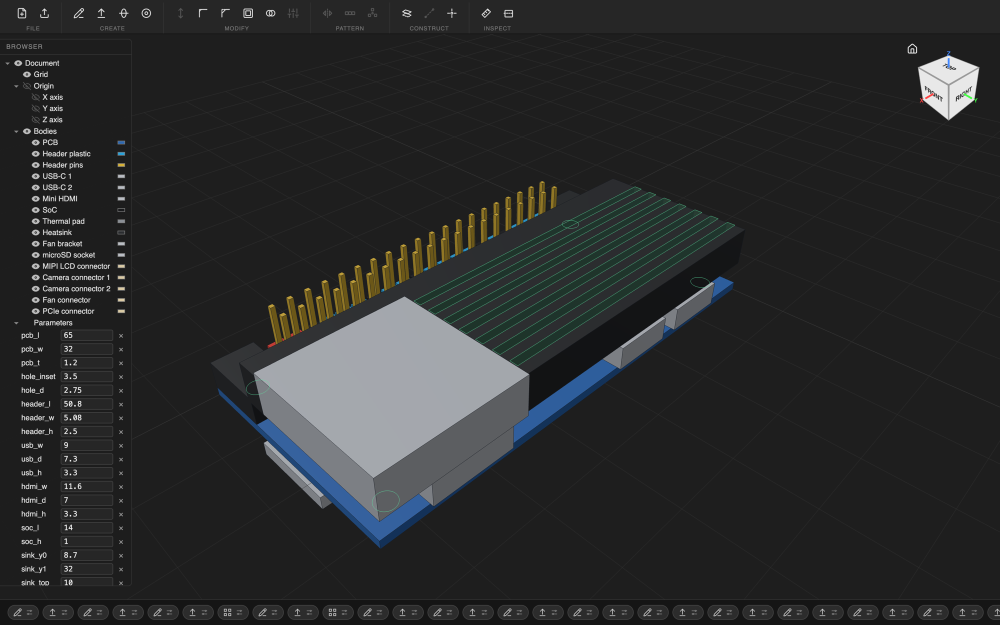

# Sprocket

A parametric CAD app for the Mac with a timeline first. Every model is a JSON list
of features. The engine replays that list to make the part. You can edit a model
by clicking in the app, or an agent can edit it through MCP. Both use the same
edit path.



*`examples/orangepi-zero-3w.sprocket`: an Orange Pi Zero 3W with 16 bodies, made
by `examples/make_orangepi_zero_3w.py`. The board size is from the vendor spec.
Most other dimensions are estimates and are marked `UNMEASURED` in the script.*

## Parts

| Path | What it is |
| --- | --- |
| `engine/` | Python engine (build123d on OCP). It replays a document, caches B-reps and exports STEP, STL and 3MF. It also runs the daemon and the MCP server. |
| `viewer/` | three.js viewport and sketcher, served as static files. |
| `app/` | Swift shell. It hosts the viewer in a WKWebView and runs the engine daemon. |
| `e2e/` | Playwright tests that drive the viewer. |
| `examples/` | Example documents and the scripts that generate them. |
| `docs/SPEC.md` | The design record and the milestone table. |

## Start

```sh
make app                     # run the Swift app from this checkout
make test                    # engine, viewer and browser tests
```

From the `engine/` folder:

```sh
uv run --extra mcp sprocket build ../examples/orangepi-zero-3w.sprocket --step pi.step
uv run --extra mcp sprocket web ../examples/orangepi-zero-3w.sprocket --port 8765
```

`sprocket web` serves the viewer at `http://127.0.0.1:8765`. Add `--no-autosave`
to look at a generated file without the viewer writing to it.

Releases (a signed DMG that updates itself) are on
[dakl/sprocket-releases](https://github.com/dakl/sprocket-releases).

## More

- [`BUILDER_AGENT.md`](BUILDER_AGENT.md): how an agent builds a part with Sprocket.
- [`CLAUDE.md`](CLAUDE.md): rules for agents that change Sprocket itself.
- [`docs/SPEC.md`](docs/SPEC.md): the design and the decisions behind it.
