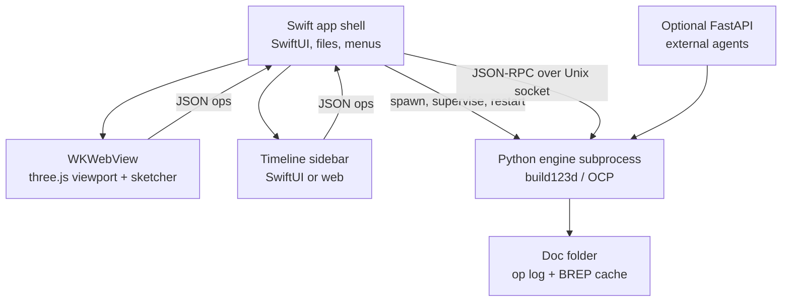
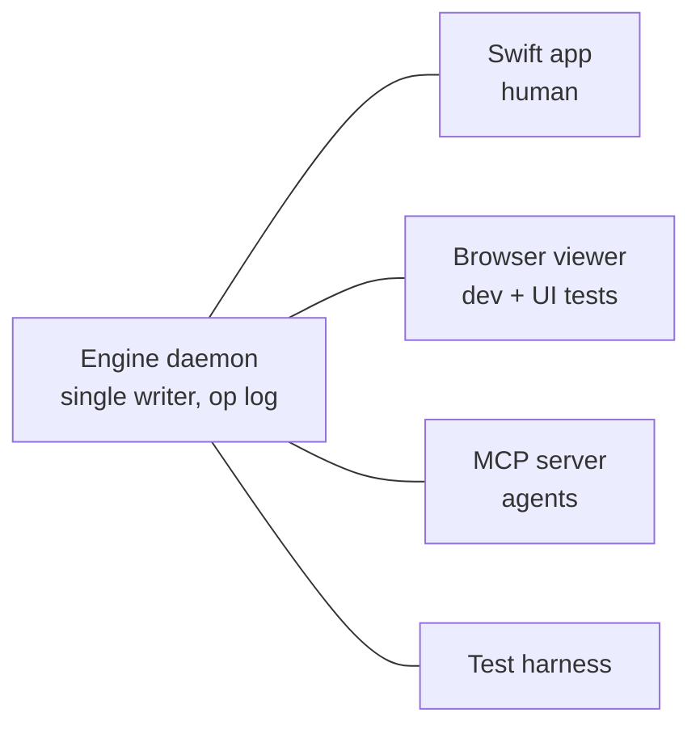

# Timeline CAD — Build Spec

Sep 24, 2026 · @Daniel Klevebring

## Vision and goals

Build a local, timeline-first parametric CAD app: every model is a replayable JSON op log, editable both from a Fusion-360-style GUI and from an API that agents can drive.

- **Timeline is the source of truth.** The model is the deterministic replay of an ordered feature list. Rollback = replay a prefix.
- **Every change is recorded.** Edits to the feature list itself go in an append-only edit log (Onshape-style microversions).
- **One write path.** GUI actions and API calls emit the same JSON ops through the same endpoint. The GUI never mutates geometry directly.
- **Manual editing is first-class.** Sketch on a plane or face, finish, then extrude, hole, fillet and so on, as in Fusion 360.
- **Agent-drivable by construction.** Every op has a JSON Schema, so every op is automatically an LLM tool.
- **Scope: real printed parts.** Single-part modeling to tier 1 (see inventory). Assemblies, sheet metal, surfacing, drawings and CAM are out of scope.

Stack in one line: JSON op log → Python interpreter → build123d (algebra mode) → OCP/OCCT, rendered in a three.js viewport inside a Swift app, all on one Mac.

## Decisions

Settled before handoff; change them here, not only in chat with an agent.

| Topic | Decision |
| --- | --- |
| UI | Hybrid: Swift shell + WKWebView hosting a three.js viewport. No Metal renderer |
| Viewer stack | Plain three.js for the viewport; React only for panels and dialogs; no react-three-fiber |
| Units | Each document declares its units, as in Fusion 360. Defaults: mm for length, g for mass. Values can be typed in any unit and are converted |
| Python tooling | `uv` with build123d and OCP pinned in the lockfile. Verify OCP installs cleanly on macOS arm64 first |
| Packaging | Not bundled for now. The app launches the engine via `uv run` from the repo's engine directory, configured by path. Bundling is deferred until there is a reason to distribute. The proposed plan is in `docs/PACKAGING.md` |
| License | Private for now; possibly public later. Not sold. No code copied from Chili3D or similar projects; they are design inspiration only. Dependencies must be compatible with a future open-source release |
| Golden approval | Every new golden needs an independent correctness check (see Testing strategy), not just a capture of current output. Existing goldens are off limits: agents never modify, regenerate or delete them without Daniel's explicit approval, including after dependency upgrades |
| Agent workflow | One milestone per session; plan first, then implement. This spec lives at `docs/SPEC.md` and is the source of truth |

## Architecture

A Swift app shell hosts a web viewport and supervises a Python geometry engine running as a child process.



Every UI surface emits ops to the shell, which forwards them to the engine; the engine is the only component that touches geometry.

| Component | Tech | Responsibility |
| --- | --- | --- |
| App shell | Swift, SwiftUI | Windows, menus, file open/save, engine process supervision, message routing |
| Viewport | WKWebView + three.js | Rendering, picking, gizmos, drag handles, live previews |
| Sketcher | three.js + planegcs (wasm) | 2D drawing and constraint solving, fully client-side |
| Engine | Python, build123d (algebra mode), OCP | Op validation, replay, caching, tessellation, selector resolution, export |
| Transport | JSON-RPC 2.0 over a Unix socket to the engine daemon (see Agent collaboration) | Request/response plus progress and cancellation |
| External API | FastAPI (optional) | Same op endpoints for agents and scripts |

Key decisions:

- **Engine runs as a subprocess, never embedded.** OCCT segfaults on bad geometry. The shell restarts the engine and replays the op log, so a crash costs one failed op, not the document. This also allows cancelling hung operations.
- **Hybrid UI, not full Metal.** three.js already has mature CAD-style line rendering and picking. A native Metal renderer roughly doubles front-end work for no modeling gain.
- **Local-only.** No auth, no sync. Documents are folders, and git provides versioning, branching and diffs.
- **Development mode:** point the app at a local Python env. Defer bundling Python + OCP into the .app (signing and notarizing hundreds of MB of dylibs) until the tool is worth distributing.

## Data model

Two logs define a document: the feature list (what the model is) and the edit log (how it got that way).

**Feature list** — ordered ops plus a rollback index. Replaying features `[0, rollback_index)` produces the model.

```json
{
  "schema_version": 1,
  "engine": {"build123d": "<pinned>", "ocp": "<pinned>"},
  "units": {"length": "mm", "mass": "g"},
  "parameters": {"wall": "2 mm", "boss_d": "screw_d + 2*wall"},
  "features": [
    {"id": "f1", "type": "sketch", "plane": "XY", "entities": [], "constraints": []},
    {"id": "f2", "type": "extrude", "profiles": [{"sketch": "f1", "bounded_by": ["e1", "e2", "e3", "e4"]}],
     "extent": {"kind": "distance", "value": "10 mm"}, "mode": "new"}
  ],
  "rollback_index": 2
}
```

**Edit log** — append-only, one entry per change to the feature list: `insert_feature`, `update_feature` (with a param diff), `delete_feature`, `reorder`, `set_rollback`, `set_parameter`. Each entry records a timestamp, author (`user` | `agent:<name>` | `api`) and the resulting feature-list hash. Undo/redo walks this log; any entry can be restored or branched from.

**Replay and caching**

- Cache key per feature = hash(feature JSON + upstream cache key + pinned engine versions).
- Cache value = the BREP of the model after that feature, stored as a `.brep` file, plus tessellation for the viewport.
- An edit invalidates that feature and everything downstream. Scrubbing the rollback bar is a cache lookup.

**Document file.** A document is one `.sprocket` file, which is the JSON above. The open and save panels offer only that extension, and the daemon's file methods refuse any other. Until M7, the edit log and BREP cache are not part of the file: the cache sits beside it in `cache/`.

**Document folder** (git-friendly, planned for M7 as `.tcad`)

```
mypart.tcad/
  document.json      # feature list + parameters
  editlog.jsonl      # append-only edit log
  cache/             # BREP + mesh per feature (gitignored)
  exports/           # STL / 3MF / STEP (optional)
```

Engine RPC surface (mirrored by the optional HTTP API): `get_document`, `apply_edit`, `preview_feature`, `set_rollback`, `resolve_selection` (pick → selector), `get_profiles`, `get_mesh`, `export`, `cancel`.

## References and topological naming

Never reference geometry by index. OCCT renumbers faces and edges when anything upstream changes, so references must be queries that re-resolve on every replay.

**3D references: build123d selector chains serialized as JSON**

```json
{"from": "part", "select": [
  {"op": "edges"},
  {"op": "filter_by", "axis": "Z"},
  {"op": "sort_by", "axis": "Z"},
  {"op": "slice", "start": -4}
]}
```

- Supported steps map one-to-one to build123d: `faces`, `edges`, `vertices`, `filter_by` (axis, plane, geom type), `sort_by`, `group_by`, `slice`, `first`, `last`.
- Add a feature-scoped step `{"op": "new_since", "feature": "f2"}`, implemented by diffing topology before and after that feature. This is the poor man's version of Onshape's feature-scoped queries and the most robust option.
- **Selector synthesis:** when the user clicks faces or edges, the engine searches candidate chains and returns the shortest one that selects exactly the picked set. Prefer chains that start with `new_since`.
- Every resolution records its expected count. A count mismatch on replay marks the feature as broken instead of silently selecting the wrong geometry.

**Sketch references: stable IDs you own**

- Sketch entities have IDs assigned by the client (`e1`, `e2`, …) that never change. Reference profiles as `{"sketch": "f3", "bounded_by": ["e1", "e2", "e5"]}`, never as "region 0".
- `bounded_by` alone can match two regions: a circle across one side of a rectangle leaves an outside half and an inside half, both bounded by that side and the circle. A profile may therefore carry `"inside": [u, v]`, a point in the region, and the engine uses it only to break that tie. A reference that matches nothing fails the extrude, as a selector count mismatch does.
- Hole centers reference sketch point entity IDs.
- Profiles therefore survive dimension changes, which is an area where this design can beat Fusion 360.

**Sketch planes**

- A sketch attaches to an origin plane (`XY`, `XZ`, `YZ`), a construction plane feature, or a planar face via a selector.
- If the face moves, the sketch moves with it. If it disappears, the sketch is flagged for re-pick.

**Determinism:** pin build123d/OCP versions per document. OCCT output is stable within a version, but upgrades can reorder topology and break selectors.

## Sketch workflow

The core interaction loop, modeled on Fusion 360: pick a plane, sketch, finish, pick profiles, apply a 3D op.


1. **Pick a plane or face.** The click becomes a plane reference: `"XY"` or a face selector. The engine returns the resolved plane (origin, local X/Y axes).
2. **Enter sketch mode.** The camera animates to look normal to the plane, and the model dims. All drawing happens in local 2D coordinates.
3. **Projected reference geometry.** The engine sends the face's boundary edges in local 2D as non-editable reference entities to snap and constrain against. *(Not built in M3. It belongs with sketch-on-face in M5.)*
4. **Draw and constrain client-side.** planegcs solves on every mouse move, with no engine roundtrips. Infer constraints while drawing (auto-horizontal, auto-coincident on snap), support inline dimension entry, and color by constraint state (Fusion convention: blue = under-constrained, black = fully constrained).
5. **Finish sketch.** Commit one `sketch` op containing entities, constraints, dimensions and solved positions. The engine trusts the solved geometry.
6. **Profiles light up.** The engine computes closed regions and returns them as pickable fills, each tagged with its bounding entity IDs.
7. **Apply an op.** Select regions, choose the op (E for extrude), drag the handle or type values, preview, commit. The M3 preview is drawn in the viewer from the region outlines the engine sends in `features.json` and `get_profiles`. It does not call `preview_feature`.

Sketch op shape:

```json
{"id": "f3", "type": "sketch",
 "plane": {"feature": "f2", "face": [{"op": "faces"}, {"op": "sort_by", "axis": "Z"}, {"op": "last"}]},
 "entities": [
   {"id": "e1", "kind": "line", "p0": [0, 0], "p1": [40, 0]},
   {"id": "e2", "kind": "circle", "c": [20, 10], "r": 4, "construction": false}],
 "constraints": [
   {"kind": "horizontal", "e": "e1"},
   {"kind": "distance", "a": "e1.p0", "b": "e1.p1", "value": "40 mm"}]}
```

What M3 shipped of the sketch op: an entity is a `line` (`p0`, `p1`), an `arc` (`c`, `r`, `a0`, `a1`, counter-clockwise from `a0` to `a1`, in radians) or a `circle` (`c`, `r`), with an optional `construction` flag that bounds no region. A constraint reference is an entity id or `<id>.<point>`, where the point is `p0`, `p1` or `c`. Kinds: `coincident`, `horizontal`, `vertical`, `parallel`, `perpendicular`, `tangent`, `equal`, `fix`, `distance`, `radius`, `diameter` and `angle` (degrees). A line's length is a `distance` between its own ends. Kinds also include `point_on` (`a` is a point, `b` the line, circle or arc it lies on). The sketch plane gives every sketch three references of its own: `origin`, and the lines `axis_u` and `axis_v` through it along the plane's x and y directions. A constraint can name them, as in `{"kind": "coincident", "a": "e1.c", "b": "origin"}`. In the viewer the pointer snaps to a point (`coincident`), else to a spot on a curve or a shown axis (`point_on`). The world axes are hidden until the browser tree's Origin rows show them. A shown world axis is snapped to only when it lies in the sketch plane, so Z on an XY sketch adds nothing the origin does not give. The engine checks that every reference resolves and otherwise ignores constraints, so a sketch replays from its solved geometry alone. The viewer solves with planegcs, bundled into `viewer/vendor/planegcs.js` (rebuild with `viewer/vendor/build-planegcs.sh`). The Swift app loads the viewer from `file://`, which refuses module scripts and a fetched `.wasm`, so the bundle is one classic script with the wasm inlined. On the dark background "fully constrained" draws light grey rather than black.

**Region detection** is the hardest engine piece in this loop. Intersecting curves form a planar arrangement: a rectangle crossed by a circle yields three regions. M3 does it by splitting a frame face, a quarter wider than the sketch on every side, along every entity (`BRepAlgoAPI_Splitter`) and dropping the cells that touch the frame. `BOPAlgo_BuilderFace` was tried first and is wrong for this: it returns maximal areas, so a circle across a rectangle came back as the rectangle plus its outside half, with no cut along the circle. Each cell's bounding ids come from which entity each of its edges lies on. Test this heavily with overlapping and tangent geometry.

**Editing an existing sketch:** double-click it in the timeline. The model rolls back to just before it, the sketcher reopens with its entities, and committing replays downstream features.

## Op framework

Engine-side, most ops are tens of lines over build123d; the cost is UI. Build shared machinery first so each new op is mostly a schema plus a small handler.

**One JSON Schema per op type** is the single definition that drives:

- input validation in the engine
- the auto-generated parameter dialog in the UI
- API docs
- LLM tool definitions for agents

**Op registry (engine)** — each op type registers `schema`, `apply(prev_shape, op, ctx) -> shape`, and optional `preview(...)`. `ctx` resolves selectors, profiles, planes and parameter expressions.

**Shared parameter types**, reused across ops:

| Type | Values | Used by |
| --- | --- | --- |
| `extent` | distance, symmetric, to-face, through-all, two-sided | extrude, revolve (angle variant), cut |
| `mode` | new body, join, cut, intersect | every create op |
| `selection` | faces, edges, vertices, profiles, points, planes, bodies; min/max count | every op that picks |
| `expression` | number with unit, or formula over named parameters | every numeric field |
| `plane_ref` | origin plane, construction plane, face selector | sketch, mirror, construction ops |

**Parameters** — a named table with expressions (`boss_d = screw_d + 2*wall`), evaluated in dependency order before replay. A parameter change invalidates every feature that uses it.

**Generic preview pipeline:** dialog change → debounced (~100 ms) `preview_feature` → ghost mesh in the viewport → commit or cancel. Show the stale preview plus a spinner for slow ops; never block the UI.

**Generic failure handling:** every feature evaluates to `ok`, `warning` (e.g. a selector count changed) or `error` (OCCT failure, empty result, broken reference). Show status icons in the timeline, keep replaying past warnings, stop the part at errors, and offer "edit" / "re-pick" actions.

## Testing strategy

An agent writes most of the code, so tests are the spec: no feature is done until it has unit tests, a golden case, and a UI test if it touches the UI.

**Definition of done for any feature**

- [ ] JSON Schema + op handler
- [ ] Engine unit tests for the handler and its edge cases
- [ ] At least one golden case in `tests/golden/` (more for each mode or extent it supports)
- [ ] Client unit tests for any new UI logic (dialogs, sketch tools, emitted ops)
- [ ] A UI test for the manual workflow, if the feature is user-facing
- [ ] Full suite green: `make test` runs everything

### Unit tests

| Layer | Framework | What to cover |
| --- | --- | --- |
| Engine (Python) | pytest + hypothesis | Op handlers, selector resolution and synthesis, expression evaluator, region detection, cache invalidation, replay determinism, RPC contract |
| Viewer (TypeScript) | vitest | Sketcher tools, constraint inference, planegcs wrapper, timeline state, op emission from UI actions, RPC client |
| Shell (Swift) | XCTest | Engine process supervision and restart, RPC bridge, document open/save |

Use property-based tests (hypothesis) for region detection and replay: random valid sketches must yield regions whose areas sum correctly, and replaying the same document twice must give identical fingerprints.

### Golden feature tests

Every feature adds a real document plus its expected output. The suite grows with the product and is the main regression net.

```
tests/golden/extrude_symmetric/
  document.json        # feature list + parameters
  expected.json        # geometry fingerprint
  expected.step        # canonical STEP
  expected.stl         # fixed-deflection STL
  expected.png         # fixed-camera render, for human and agent review
  README.md            # one line: what this case proves
```

Output comparison is layered, because byte-identical STEP/STL alone is brittle:

1. **Fingerprint (primary assertion).** Volume, surface area, bounding box, center of mass (to a tolerance such as 1e-6 relative), plus exact counts of solids, faces, edges and vertices, and a histogram of face types (plane, cylinder, cone, B-spline). This survives harmless changes and catches real ones.
2. **Geometric equality.** Boolean symmetric difference between the output and `expected.step` must have volume ≈ 0. This catches shape changes a fingerprint could miss.
3. **Byte identity (within a pinned engine version).** Canonical STEP with the header timestamp and author fields normalized, and STL with fixed tessellation parameters, hashed and compared. Upgrading OCCT will legitimately change these, which is why they are not the only check.

More golden case types:

- **Parametric variants:** the same document with parameter overrides, each with its own expected fingerprint.
- **Edit-sequence cases:** a document plus an edit log (e.g. change an upstream dimension). Assert that downstream features still resolve and the result matches. This is the regression net for topological naming.
- **Expected-failure cases:** documents that must produce a specific feature error, not a crash.

**A golden only proves "same as before", not "correct".** If the agent implements a feature and then captures its own output as the golden, a bug gets frozen in and the suite defends it forever. So every new golden needs one independent correctness check at creation time:

- **Analytical assertions, written before the implementation.** A 40 × 20 × 10 mm extrude has volume 8000 mm³, 6 faces, 12 edges; a 2 mm fillet on one edge removes a known volume. Put these in the case's `checks.json` first, then implement until they pass.
- **Reference script.** Build the same part directly in a short build123d script, bypassing the op interpreter, and assert the symmetric difference ≈ 0. This checks the interpreter against the library.
- **Human review** only when neither is feasible (e.g. complex sketches): glance at `expected.png`. Keep these cases rare.

After creation, goldens run automatically and are **locked**: agents may create new cases but never modify, regenerate or delete existing ones without Daniel's explicit approval. `make golden-update CASE=<name>` refuses existing cases unless run with `--approved`, which only Daniel passes.

**Dependency upgrades** (OCCT, build123d) are the main reason goldens exist. Upgrade on a branch and run the suite, then:

1. Fingerprint and symmetric-difference failures = real geometry change. Investigate; never regenerate blindly.
2. Byte-hash-only failures = expected churn (topology ordering, STEP serialization). Once all geometry checks pass, the agent proposes a bulk hash regeneration listing the affected cases; Daniel approves it.
3. Edit-sequence failures = selectors broke. Fix the selector or synthesis logic, not the golden.

### UI tests an agent can drive

The viewer must run in a plain browser, not only inside the Swift app. This is the key architecture requirement for agent-driven UI testing.

- **Transport abstraction.** The viewer talks to the engine through an interface with two implementations: the WKWebView message bridge (in the app) and an HTTP bridge (in the browser, via `sprocket web`, a small dev server). The viewer sends every gesture through one `sendCommand()`. The rules that turn a gesture into document edits live once, in `viewer/edits.js`. The call goes to the daemon's `apply_edit`: through Swift in the app, and as `POST /rpc` in the browser. Server-sent events (`GET /events`) carry edits made by other clients, such as an agent on the daemon socket. It is plain HTTP rather than a WebSocket because the Python stdlib has no WebSocket server and this does the same job. Tests and agents use the browser path.
- **Playwright end-to-end tests** drive the real viewer against a real engine: open a document, click, drag, type, and assert on results.
- **Test hooks, not pixel guessing.** In test builds, expose `window.__tcad` with read access to state (timeline, feature statuses, selection, sketch entities and constraint state, camera) and helpers such as `screenPointOf(entityOrFaceId)`. Tests then click real screen positions derived from model state, which keeps them stable.
- **Fake engine for fast client tests.** A mock engine replaying recorded RPC fixtures, so UI logic tests run in milliseconds without OCCT.
- **Visual regression.** Playwright screenshots from fixed cameras with a perceptual-diff threshold, for rendering changes only, not as the main assertion.
- **Swift shell.** Keep it thin so XCTest covers it; XCUITest only for a smoke test (launch, open document, engine connects).

Example UI test flow: open an empty document, pick the XY plane, draw a rectangle, add two dimensions, finish the sketch, select the profile, extrude 10 mm, then assert the timeline has two features with status `ok` and the fingerprint matches `golden/rect_extrude`.

### CI and local loop

- `make test` = engine unit tests, client unit tests, golden suite, Playwright suite (headless).
- Fast inner loop for agents: `make test-engine` and `make test-golden CASE=…` run in seconds.
- CI runs on macOS arm64 to match the target machine and the pinned OCCT build.

## Agent collaboration

Humans and agents edit the same live document through the same op log; the engine is the single writer and every client, human or agent, is a peer.

**Architecture change this requires:** the engine runs as a local daemon on a Unix socket, not a stdio child of the app. The Swift app, the browser viewer, the MCP server and the test harness all connect to it. The app still launches and supervises it.



**MCP server** (a thin adapter over the engine RPC). Op tools are generated from the op JSON Schemas, so every new op is instantly agent-callable.

| Tool | Purpose |
| --- | --- |
| `get_document`, `get_timeline` | Read the feature list, parameters, statuses and rollback index as JSON |
| `apply_edit` | Insert, update, delete or reorder features; guarded by document revision |
| `set_rollback`, `set_parameter` | Scrub the timeline, change parameters |
| `preview_feature` | Try an op without committing; returns fingerprint and status |
| `render_view` | PNG from a named or given camera, with optional highlighted faces/edges — the agent's eyes |
| `describe_geometry` | Faces and edges with stable handles and plain descriptions ("planar face, normal +Z, top of f2") so agents can reason about what to select |
| `resolve_selection` | Turn handles into a robust selector chain |
| `measure` | Distances, angles, volume, bounding box |
| `get_selection`, `highlight` | Read what the human has selected; point things out to the human |
| `export` | STL, 3MF, STEP |

**Shared session rules**

- **Optimistic concurrency.** Every edit carries the document revision it was based on. Stale edits are rejected with the current state, and the agent re-reads and retries. No locks.
- **Attribution.** Edit log entries record `user` or `agent:<name>`. The timeline shows who added each feature.
- **Live updates.** All clients subscribe to document change notifications, so a human watches agent edits land in real time, and vice versa.
- **Proposal mode.** An agent can work on a branch of the edit log; the human sees a diff (added and changed features, before/after renders) and accepts or rejects it. This is the default for larger agent changes.
- **Selection as conversation.** "Fillet these" works because the agent can read the human's current selection; the agent can highlight geometry to ask "these edges?".

**Why this also serves development:** the same MCP and render tools let a coding agent verify its own work — build a part through the API, render it, measure it, and compare against the golden. `render_view` output is the same image that goes into `expected.png`.

Agent-facing golden cases: include a few documents built entirely through MCP calls from a recorded script, so the agent interface itself is regression-tested.

## Operation inventory

Tier 1 is the target for "can design real printed parts"; tier 2 follows soon after; tier 3 is explicitly out of scope.

**Tier 1 — can't live without**

| Area | Operations | Engine side |
| --- | --- | --- |
| Sketch | line, arc (3-point, tangent), circle, rectangle, slot, polygon, construction toggle, dimensions, constraints | planegcs + own code |
| Sketch editing | trim, extend, offset, mirror, 2D fillet, project edges | trim is painful; rest moderate |
| Create | extrude (distance / to-face / symmetric / taper), revolve | `extrude(until=…)`, `revolve` |
| Modify | fillet, chamfer, shell, hole (simple / counterbore / countersink) | built into build123d |
| Combine | new / join / cut / intersect mode on every create op; standalone combine | `+ - &` |
| Pattern | mirror, linear pattern, circular pattern | `mirror`, `Locations`, `PolarLocations` |
| Construction | offset plane, plane at angle, midplane, axis through edge or points, point | cheap, essential |
| Parameters | named user parameters with expressions | evaluator + dependency ordering |
| Output | STL, 3MF, STEP export | built in |

Sketch constraints for the MVP: coincident, horizontal, vertical, parallel, perpendicular, tangent, equal, distance, radius/diameter, angle, fix.

**Tier 2 — wanted within weeks of daily use**

| Area | Operations |
| --- | --- |
| Surface-driven | sweep, loft |
| Body editing | split body, move/copy body |
| Face editing | offset face / press-pull |
| Molding and fasteners | draft, threads (cosmetic by default; bd_warehouse for modeled) |
| 2D input | text in sketches, splines |
| Inspection | measure, section view (not timeline ops) |

**Tier 3 — out of scope:** assemblies with joints and motion, sheet metal, freeform/T-spline surfaces, 2D drawings, CAM. Each is as large as everything above combined.

## Risks and gotchas

The sketcher UX and topological naming are the two things most likely to sink the project; the rest are known engineering problems.

| Risk | Impact | Mitigation |
| --- | --- | --- |
| Topological naming | Upstream edits silently break or retarget fillets, holes and sketch planes | Selector chains, `new_since`, expected counts, stable sketch entity IDs, clear re-pick UX |
| Sketcher UX effort | Months of work; clunky feel for a long time | Start with a small entity and constraint set; copy Fusion conventions outright |
| OCCT segfaults | A crash takes down the engine | Subprocess isolation, auto-restart, replay from op log |
| OCCT operation failures | Fillets and booleans fail on edge cases | Generic failure states in the timeline, never crash the replay |
| Slow ops (complex fillets) | Laggy previews | Per-feature BREP cache, debounced previews, cancellation |
| Region detection | Wrong or missing profiles on overlapping curves | General fuse + face building; a dedicated test suite of tricky sketches |
| Version drift | OCCT upgrades reorder topology, breaking selectors | Pin build123d/OCP per document; golden-file replay tests before upgrading |
| Packaging | Signing and notarizing a bundled Python + OCCT runtime | Defer; use a local Python env during development |
| Scope creep | Assemblies, sheet metal and so on eat the project | Tier 3 is a hard no until tier 1 is done |

Testing is specified in full under Testing strategy; the golden suite with edit-sequence cases is the main defense against the topological naming and version drift risks.

## Build order and milestones

The first proof of concept is the sketch → profile → extrude loop working end to end with timeline replay; everything else layers on top.

| # | Milestone | Scope | Done when | Agent effort | Human bottleneck |
| --- | --- | --- | --- | --- | --- |
| M0 | Headless engine | Op registry, JSON Schemas, replay, BREP cache, selector resolution; sketch (dimensioned primitives, no solver), extrude, revolve, boolean, fillet, chamfer; STL/STEP export | A JSON document replays to a correct part from the CLI; golden tests pass | Hours to a day | Low: review schemas and first goldens |
| M1 | Engine daemon + agent API | Engine daemon with JSON-RPC over a Unix socket, MCP server, optional FastAPI, edit log, rollback, parameters | An agent can read the timeline and append ops | Hours to a day | Low: try the MCP tools yourself |
| M2 | Viewer + timeline | Swift shell, WKWebView three.js viewport, picking with face/edge ID map, timeline sidebar with rollback bar, auto-generated param dialogs | Open a document, scrub the timeline, edit a feature's params by form | A few days | Medium: viewport feel, WKWebView/signing friction |
| M3 | Sketch → extrude loop | Plane pick, sketch mode, planegcs with lines/arcs/circles + basic constraints, region detection, profile picking, extrude with drag handle and live preview | Sketch a part from scratch in the GUI and extrude it | Days | High: sketcher feel needs many hands-on iterations |
| M3.5 | Files | New, Open, Save As, Open Recent, STEP/STL export, window title, reopen the last document | Open a part from the File menu, edit it, and save a copy under another name | Hours | Low: try the menus yourself |
| M3.7 | Constraint list | Constraint glyphs drawn beside the geometry they act on, with a show/hide toggle. Select a glyph to highlight its entities. Delete removes a constraint. Double-click edits a dimension, and Delete removes it. Undo and redo inside a sketch. Over-constraint is refused with the conflicting constraint named | Draw a rectangle, add a dimension, change its value, delete a constraint, and undo each step without leaving the sketch | Days | Medium: glyph placement and the feel of selecting small targets |
| M3.8 | Sketch edits for agents | Constraints get stable ids. Sketch-level edits `add_constraint`, `update_constraint` and `remove_constraint`, plus entity edits, act inside one sketch and are daemon methods and MCP tools. The engine solves: every sketch edit returns solved geometry, whoever made it | An agent adds a dimension to a sketch while the viewer is open, the geometry moves, and the human sees it live | Days | Medium: the solver choice, and keeping one solver on both sides |
| M4 | Selector synthesis | Pick → shortest selector, `new_since`, broken-reference UX | Fillet picked edges survive upstream dimension changes | Days | Medium: judging which references feel right |
| M4.5 | Selection as conversation | `set_selection` daemon method that the viewer calls on every pick, `get_selection` and `highlight` as daemon methods and MCP tools, a `selection_changed` notification, and a `selection` field in `describe_geometry` | Select two edges in the viewport, tell the agent "fillet these", and it reads the edges and adds the fillet | Hours to a day | Low: try it with an agent in the app |
| M5 | Tier 1 complete | Sketch-on-face, projection, remaining tier 1 ops and sketch tools, construction geometry, 3MF export | Design a printed bracket faster here than in Fusion | Weeks, mostly parallelizable per op | High: real-part dogfooding surfaces the gaps |
| M6 | Tier 2 | Sweep, loft, split, draft, threads, measure, section | As needed | Per op | As needed |
| M7 | Document package | `.tcad` folder with `document.json`, `editlog.jsonl`, `cache/` and `exports/`. The app declares the type as a package, so Finder shows one file. Bundles the app, which the Packaging decision defers. `.sprocket` keeps opening | Open and save a `.tcad` from the File menu, and a double-click in Finder opens it | Days | Medium: signing and bundling friction |
| M8 | Quick Look | Space on a `.sprocket` or `.tcad` in Finder shows the part. A Quick Look preview extension in the bundle builds the document through the engine and shows the mesh. Needs M7's bundle | Select a document in Finder, press space, and see the part | Days | Medium: extension sandboxing, and whether it can reach the engine |

**M3.5, files.** The engine writes every edit of a named document to its file as it happens, so nothing is ever unsaved and a titled document has no Save. A new document has no name yet, so it lives in Application Support until Save As names it, and the next launch reopens whatever was open last. `open_document`, `new_document` and `save_as` are daemon methods that the app's menus call. They are not MCP tools: an agent edits the open document and does not swap it. Opening replaces the document and clears the undo history, writes nothing, and announces `document_changed` with `opened: true`, so a viewer drops its selection and sketch, refits the camera and refetches under a fresh URL. A revision number is only unique within one document, so nothing may cache by revision alone. Known gaps: an agent's `base_revision` carries no document identity, so a stale edit from before an open can land on the new document if the numbers match. Tabs and several windows are not built. They need one daemon per document, or a daemon that holds several, and that choice is open.

**M3.7, constraint list.** M3 can add every constraint and dimension but cannot take one away (checked 2 Oct 2026). `removeConstraint` in `viewer/sketch-model.js` has no caller, and Delete only removes entities along with the constraints that mention them. The milestone copies Fusion: a glyph beside each constrained entity, a toggle that hides the glyphs, selecting a glyph highlights what it acts on, and a dimension is a label that is edited in place. Constraints and dimensions follow one rule: the model removes or edits them by index, the solver reruns, and the sketch is sent to the daemon as one `update_feature`. Undo inside a sketch is in scope, because deleting a constraint by mistake otherwise loses work, and M3 has no undo while sketching. Open questions: whether a dimension may name a parameter, as Fusion's `d1` does (the daemon already has `set_parameter`), and whether to add driven (reference) dimensions. Both are cut candidates.

**M3.8, sketch edits for agents.** Constraints and dimensions are not ops today (checked 2 Oct 2026). A dimension is a `distance` entry in a sketch's `constraints` list, and the viewer changes it by sending `update_feature` with the whole sketch. The daemon's edit kinds are `insert`, `update`, `delete`, `move`, `set_rollback` and `set_parameter`, so an agent cannot touch one constraint. Two things block it. First, the engine does not solve: `ops/sketch.py` trusts the geometry that the viewer's planegcs placed, so a constraint an agent adds would be stored and nothing would move until a viewer re-solved. Second, constraints are addressed by index, which breaks when two clients edit at once. The milestone gives each constraint a stable id, as entities have, and adds sketch-level edits (`add_constraint`, `update_constraint`, `remove_constraint`, and the entity edits) that act inside one sketch. They are not timeline ops, because one timeline row per constraint would bury the real features. The M3.7 viewer sends the same edits, so one set of rules serves both clients. The open decision is the solver. Running planegcs under Node from the engine keeps one solver on both sides, so results cannot drift, but it adds Node to the engine. A Python solver avoids Node and gives two solvers that may disagree. Settle it with a spike before the milestone starts. M3.7 does not depend on M3.8, so the UI ships first.

**M3.7 and M3.8, as built.** One PR carries both. A constraint has a stable id (`c1`). The daemon methods are `add_constraint`, `update_constraint`, `remove_constraint`, `add_entity`, `update_entity` and `remove_entity`, all one `edit_sketch` edit in `apply_edits`, so undo, the log and `base_revision` cover them. The engine solves after each one and refuses a set with no solution, naming the conflicting constraint ids. The solver is still the optional `solver` extra, and a missing install gives a clear error. Three departures from the plan above. First, the MCP tools are `sketch_add_constraint` and so on, because every tool that starts with `add_` is an op. Second, the viewer does not send `edit_sketch`. It sends the whole sketch with one `update` per change and a `base_revision`, so a viewer in the app needs no solver in the engine. On a stale revision it re-reads: if the sketch is unchanged it sends again, and if an agent changed it the agent's version wins and the viewer says so. Third, a sketch already in the document is saved as you work, so Cancel puts back what it was when the sketcher opened. A new sketch still waits for Finish. Undo and redo inside a sketch are local to the sketcher. The two open questions are settled by cutting both: a dimension cannot name a parameter yet, and there are no driven dimensions.

**M4.5, selection as conversation.** The agent cannot read the human's selection today (checked 2 Oct 2026). The viewer holds it in its own state (`selectedEdge`, the selected face, the selected sketch) and never sends it to the daemon. The daemon has no `get_selection`, `set_selection` or `highlight` method, and the MCP server has no selection tool, although the tool table above lists `get_selection` and `highlight`. So "fillet these" has no way to reach the agent. The fix is one place for the selection: the daemon stores it, and every viewer transport (the WKWebView `rpc` message and `POST /rpc`) sets it through `sendCommand()`. It holds handles from `describe_geometry` (face and edge indices, sketch ids, the document revision it was taken at), and `get_selection` returns those with the plain descriptions. A selection taken at an older revision is returned with `stale: true`, because a rebuild renumbers faces and edges. `highlight` pushes handles to the viewer over the same event stream that carries document changes. The raw-handle part does not need M4. After M4 the selection also carries a selector, so it survives an upstream edit. Opening a document clears the selection, as it clears undo.

**M4.5, as built.** The daemon holds the selection: `set_selection` (the viewer calls it on every pick, with the revision it picked at), `get_selection`, and `highlight`. `get_selection` returns the handles, the sketch ids, the revision and `stale`, plus `describe_geometry`'s entry for each handle (sentence, centre, length or area), which is what an agent builds a `nearest_to` selector from. When the part was rebuilt since the pick, `stale` is true and the entries are left out, because `f2` may be another face. `describe_geometry` also carries `selection`. Notifications are `selection_changed` and `highlight`. The browser gets them as server-sent events of the same name, and the app through `EngineDaemon.onHighlight`. Opening or creating a document clears the selection. The viewer reports faces, edges and one sketch. It does not report picked regions, and `highlight` paints faces and edges but only records sketch ids. After a rebuild the viewer clears its own selection, so a stale selection mostly lives in the gap. This milestone does not need M4: the handles are raw indices. After M4 the selection should also carry a selector.

**M4, as built (engine, and push/pull in the viewer).** `resolve_selection` (a daemon method and an MCP tool) turns picked handles into a selector. With no handles it uses the person's current selection, and it refuses a stale one. The reply has the selector with an `expected_count`, and a `strategy`. `new_since` and `structure` follow the geometry. `position` only follows where it is, and says so. Two steps are new. `new_since` keeps what a feature made or changed, found by comparing geometry with the shape the feature was applied to, not by OCCT identity, because each feature's result is cached on its own. `at_end` keeps everything level with the highest or lowest item along an axis, which is how "the top edges" is said. `nearest_each` names a set by the nearest item to each point, and is the fallback. A selector with `expected_count` fails the feature when a rebuild finds another number. The search tries `new_since` first, then the shortest chain. It leaves out sort-and-slice chains on purpose: a slice by count always returns the same number, so `expected_count` cannot catch it picking the wrong items. In the viewer only push/pull uses it. There is no fillet gesture to wire yet, and the broken-reference UX is not built: a feature whose selector no longer matches shows as failed in the timeline with the engine's reason.

**File type, added after M3.5.** Documents are `.sprocket`, not `.json`, so the Open dialog and a directory listing say what the file is. The `.sprocket` suffix is checked in `rpc.py`'s `_file_path`. Finder association and a Quick Look preview both need an app bundle, so they wait for M7 and M8. The type has no Info.plist declaration until then: `DocumentStore.swift` builds it from the extension.

Agent effort is a rough guess, not a plan. Code gets written fast; the real clock is set by OCCT edge cases the agent must discover by testing, and by human review and hands-on UX judgment. From M3 on, your time in the app is the constraint, not the agent's.

Test and agent infrastructure lands early, not at the end: M0 ships the golden harness and fingerprinting, M1 ships the MCP server and `render_view`, and M2 ships the browser transport, `window.__tcad` hooks and the first Playwright tests. From M3 on, every feature follows the definition of done.

Suggested repo layout:

```
engine/        # Python: ops/, selectors/, replay.py, cache.py, rpc.py, api.py, schemas/
  tests/       # golden documents + replay tests
viewer/        # TypeScript: three.js viewport, sketcher, planegcs, timeline UI
app/           # Swift: shell, process supervisor, WKWebView bridge
examples/      # sample .sprocket documents
```

First Claude Code task: scaffold `engine/` with the op registry, JSON Schemas for `sketch`, `extrude` and `fillet`, a replay loop with BREP caching, the golden test harness (fingerprint, symmetric-difference check, normalized STEP/STL hashes), three golden cases, and a CLI that replays a document and exports STEP, STL and a PNG render.

## References

Use these as dependencies or design references; only build123d, OCP and planegcs are planned dependencies.

| Name | Role here | Notes |
| --- | --- | --- |
| build123d | Geometry API (dependency) | Use algebra mode; selectors are the reference language |
| OCP / OpenCascade (OCCT) | Kernel (dependency) | Pin versions per document |
| planegcs | Sketch constraint solver (dependency) | FreeCAD's solver; wasm build on npm |
| bd_warehouse | Modeled threads, fasteners (tier 2) | Optional |
| Onshape | Design reference | Feature list JSON API, microversions, query-based references |
| Fusion 360 | UX reference | Sketch workflow, timeline, feature failure icons |
| [Chili3D](https://github.com/xiangechen/chili3d) | UI code reference | Study its three.js viewport, highlighting, snap/track; not a base (object-tree model, OCCT in wasm). Check its license before copying code |
| Zoo Design Studio (KCL) | Design reference | Code-as-model approach to agent-friendly CAD |
| ocp_vscode, yacv | Interim viewers | Useful for inspecting engine output before M2 |

Non-goals, restated: no cloud, no multi-user, no assemblies, no second kernel in the browser.
